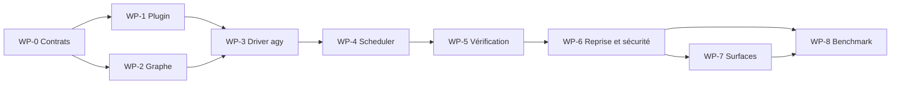

# Plan d'implémentation de Oh My Antigravity

Ce plan est subordonné à ADR-001. Toute tâche qui réactive un nœud, poursuit une
conversation ou implémente une boucle autonome est invalide.

## Pari produit

Utilisateur cible : développeur utilisant Antigravity CLI pour des tâches de coding longues, complexes et potentiellement parallèles.

Travail à accomplir : confier une mission une fois, suivre un état intelligible, reprendre après interruption et recevoir une preuve que le résultat fonctionne.

Alternative actuelle : piloter manuellement Antigravity, ou adapter OMC/OMO/OMX au prix d'un mauvais alignement avec le harness.

Raison de changer : obtenir la discipline et la reprise des meilleurs plugins sans perdre les capacités natives d'Antigravity ni imposer tmux.

Hypothèse la plus risquée : un graphe durable améliore réellement le taux de réussite et la reprise par rapport à un plugin composé uniquement de skills et de prompts.

## Plus petit test utile

Avant le produit complet, construire une tranche verticale unique :

```text
installer plugin -> lancer une mission à trois nœuds -> déléguer deux nœuds indépendants
-> interrompre -> reprendre -> vérifier -> exporter le graphe et les preuves
```

Le test porte sur un dépôt fixture, avec une erreur volontaire et un redémarrage de processus. Si cette tranche n'améliore pas la reprise et la traçabilité, le moteur de graphe doit être simplifié ou abandonné avant d'élargir le catalogue.

## Work packages

### WP-0 — Contrats et baseline

Livrables :

- schéma JSON des nœuds, relations, événements et verdicts ;
- contrat de transition et d'idempotence ;
- protocole de benchmark commun ;
- trois missions fixtures représentatives ;
- inventaire des capacités de la version minimale d'`agy`.

Acceptance :

- tous les exemples de graphe valident le schéma ;
- chaque état terminal a une définition observable ;
- les métriques ne dépendent pas d'un fournisseur précis ;
- le périmètre MVP et les non-objectifs sont approuvés.

### WP-1 — Bundle plugin natif

Livrables :

- `plugin.json` conforme au schéma officiel ;
- six agents initiaux ;
- skills `oma-plan`, `oma-run`, `oma-review`, `oma-resume`, `oma-doctor` ;
- règles de graphe, vérification et sécurité ;
- build qui produit un bundle déterministe.

Acceptance CLI :

1. `agy plugin install <bundle>` termine avec code 0 ;
2. `agy plugin list` affiche OMA ;
3. `agy agents` affiche les agents OMA ;
4. `/skills` ou la commande équivalente affiche les skills ;
5. désactiver le plugin désactive aussi ses hooks.

QA manuelle obligatoire : exécuter ces scénarios dans une vraie TUI authentifiée, pas seulement inspecter les fichiers installés.

### WP-2 — CLI et stockage graphe

Livrables :

- commandes `setup`, `doctor`, `run`, `resume`, `status`, `graph`, `inspect`, `cancel` ;
- journal `events.jsonl` append-only ;
- projection `graph.json` reconstruisible ;
- locks, leases et écritures atomiques ;
- sorties `--json` stables.

Acceptance :

- interrompre une écriture ne corrompt pas le journal ;
- reconstruire la projection produit le même hash logique ;
- rejouer le même événement ne double pas la mutation ;
- deux writers concurrents ne possèdent pas le même nœud ;
- `doctor --json` distingue configuration, authentification, droits et version.

### WP-3 — Adaptateur `agy` borné par nœud

Livrables :

- une invocation `agy -p` indépendante par dispatch ;
- parser du résultat final structuré ;
- corrélation conversation, tour, tool et subagent ;
- gestion des codes de sortie et timeouts ;
- redaction des secrets dans les preuves.

Acceptance :

- un dispatch ne peut produire qu'une invocation ;
- une sortie JSON invalide termine le nœud en échec ;
- les diagnostics restent séparés de la réponse ;
- un résultat `ERROR`, `CANCELED`, `INTERRUPTED` ou `WAITING` produit l'état graphe attendu ;
- aucune reprise de conversation n'est utilisée pour exécuter un nœud.

### WP-4 — Planification et ordonnanceur DAG

Livrables :

- transformation d'une mission en DAG validé ;
- détection des dépendances, conflits de fichiers et gates ;
- scheduler des nœuds `ready` ;
- délégation native Antigravity ;
- limites de parallélisme et profondeur ;
- messages inter-agents bornés.

Acceptance :

- deux tâches indépendantes partent en parallèle ;
- deux tâches en conflit ne partent jamais simultanément ;
- une dépendance bloquée empêche son descendant ;
- un sous-agent n'accède qu'aux outils et workspaces autorisés ;
- le parent vérifie les résultats avant intégration.

### WP-5 — Gates de vérification et hooks

Livrables :

- hooks plugin minimaux ;
- contrats de preuve par type de work item ;
- collecteurs build, test, diagnostic et QA ;
- Stop gate borné ;
- rapport de provenance.

Acceptance :

- un self-report sans observation ne termine pas le nœud ;
- un test en échec termine le nœud et active uniquement ses arêtes `failure` ;
- le Stop hook n'effectue aucune continuation ;
- désactiver OMA libère immédiatement la continuation ;
- la preuve indique commande, code de sortie, artefact, horodatage et run parent.

### WP-6 — Reprise, récupération et sécurité

Livrables :

- reprise après crash ou compaction ;
- expiration/récupération des leases ;
- cancellation hiérarchique ;
- politique de permissions restrictive ;
- sandbox et dry-run ;
- migration de schéma versionnée.

Acceptance :

- tuer le processus au milieu d'un tool call puis reprendre ne répète pas une mutation confirmée ;
- un worker mort termine le nœud en échec et active un successeur déclaré ;
- annuler une mission arrête ses descendants sans toucher les autres missions ;
- une version de schéma inconnue échoue fermée ;
- aucun secret de fixture n'apparaît dans les logs ou graphes.

### WP-7 — Compatibilité des surfaces Antigravity

Ordre :

1. CLI Windows ;
2. CLI Linux et macOS ;
3. Antigravity 2.0 ;
4. IDE Antigravity ;
5. SDK, seulement si un gap confirmé subsiste.

Acceptance :

- le même bundle charge sur chaque surface officiellement compatible ;
- les capacités absentes sont détectées et dégradées explicitement ;
- aucune promesse de parité visuelle n'est faite ;
- les opérations durables disposent toujours d'un fallback CLI.

### WP-8 — Benchmark de parité

Comparer OMA à :

- Antigravity nu avec le même modèle et le même effort ;
- OMA skills-only sans moteur de graphe ;
- lorsque reproductible, un workflow analogue OMC/OMO/OMX sur son harness natif.

Métriques :

- taux de missions acceptées sans intervention ;
- taux de reprise après interruption ;
- défauts détectés avant handoff ;
- faux positifs de completion ;
- conflits d'écriture ;
- durée totale et durée critique ;
- appels modèle, tokens d'entrée/sortie/cache ;
- nombre de branches d'échec, révisions de graphe et décisions humaines ;
- surcharge OMA par rapport à Antigravity nu.

Critère de décision : OMA doit améliorer de façon reproductible la réussite ou la reprise sur les missions longues. Une augmentation du nombre d'agents ou de tokens n'est pas un succès.

## Ordre de dépendance



Les WP-1 et WP-2 peuvent avancer en parallèle après verrouillage de WP-0. Tous les autres suivent le chemin critique.

## Stratégie de tests

### Tests de contrat

- validation JSON Schema ;
- transitions autorisées/interdites ;
- invariants du DAG ;
- compatibilité des événements headless ;
- manifests plugin et hooks ;
- outputs CLI JSON.

### Tests d'intégration

- faux processus `agy` émettant des flux NDJSON déterministes ;
- vrais sous-processus avec arrêt brutal ;
- accès concurrent au journal ;
- plugin installé dans un home Antigravity isolé ;
- reprise de conversation.

### QA de surface

- TUI CLI authentifiée ;
- mission réelle sur dépôt fixture ;
- inspection `/agents`, `/skills`, `/hooks`, `/tasks` ;
- approbation et refus d'une mutation ;
- arrêt et reprise ;
- observation du diff et des preuves ;
- désactivation/désinstallation du plugin.

Une validation statique des fichiers ne remplace aucune de ces observations.

## Risques et réponses

| Risque | Signal précoce | Réponse |
|---|---|---|
| Le graphe ajoute plus de coût que de fiabilité | tokens et durée augmentent sans gain de reprise | réduire les types de nœuds ou rester skills-only |
| Les hooks cassent les éditions futures d'Antigravity | erreurs de chargement ou plugin impossible à désactiver | hooks minces, version minimale, tests de compatibilité |
| Le LLM produit des DAG trop complexes | trop de nœuds, faible parallélisme utile | limites de taille et normalisation déterministe |
| Conflits entre sous-agents | écritures concurrentes ou merges fréquents | scopes de fichiers, leases et détection de conflits |
| Routage modèle instable | rôle indisponible selon compte/version | capacités sémantiques et fallback explicite |
| État divergent | journal et projection ne concordent plus | journal canonique, rebuild et hash logique |
| Le projet devient un clone multi-harness | multiplication d'adaptateurs non testés | CLI Antigravity comme gate avant toute expansion |

## Gate avant de coder

La phase d'implémentation peut commencer lorsque :

- la rétro-ingénierie est acceptée ;
- l'architecture à deux couches est acceptée ;
- le sens de « graph engineering » est confirmé comme graphe de capacités, d'exécution et de preuve ;
- la version minimale d'Antigravity CLI est choisie ;
- les trois missions de benchmark sont définies ;
- l'environnement de QA dispose d'une authentification Antigravity fonctionnelle et de droits d'écriture sur son home.

Sans ces éléments, la prochaine action correcte est WP-0, pas l'écriture du runtime complet.
