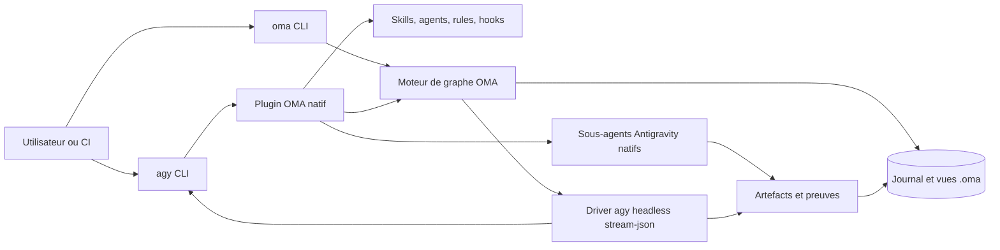
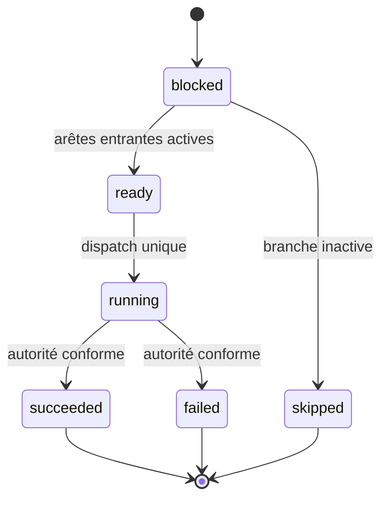

# Architecture cible de Oh My Antigravity

Statut : ADR-001 accepté ; Graph Kernel DAG implémenté le 28 août 2026.

## Décision

Oh My Antigravity, abrégé `OMA`, sera un plugin Antigravity natif piloté par un moteur de graphe local et léger.

La solution aura deux couches obligatoires :

1. un bundle Antigravity standard pour les agents, skills, règles et hooks ;
2. une CLI `oma` pour le graphe durable, la reprise, l'observabilité et les commandes d'administration.

Une troisième couche fondée sur le SDK Python Antigravity restera optionnelle et postérieure au MVP. Elle ne sera ajoutée que pour un cas que la CLI et les plugins natifs ne savent pas couvrir.

## Principes

- CLI d'abord : toute capacité critique doit être utilisable, testable et récupérable depuis le terminal.
- Natif d'abord : utiliser les sous-agents, hooks, permissions, skills et sorties structurées d'Antigravity avant d'ajouter un runtime parallèle.
- Graphe explicite : dépendances, autorité, artefacts, vérifications et transitions sont des données typées, pas seulement des consignes dans un prompt.
- Preuve avant déclaration : une tâche n'est terminée que si son nœud de vérification possède une preuve observable.
- Reprise déterministe : un redémarrage reconstruit l'état depuis le journal et non depuis la mémoire du LLM.
- Routage sémantique : les rôles expriment des capacités et un niveau d'effort ; le modèle exact est résolu tardivement.
- Adaptateurs minces : le cœur ne dépend pas de la TUI, d'Antigravity 2.0 ou de l'IDE.
- Sécurité restrictive : permissions et outils sont limités par rôle, workspace et type de nœud.

## Vue d'ensemble



Le plugin donne à Antigravity le vocabulaire et les garde-fous. La CLI `oma` possède l'état durable et exécute les transitions. Le modèle ne modifie jamais directement l'état canonique : il demande une transition, le moteur la valide, puis l'enregistre.

## Les trois graphes

### 1. Graphe de capacités

Le graphe de capacités est statique pour une version du plugin. Il répond à « qui peut faire quoi, avec quels outils et quel coût ? ».

Nœuds principaux :

- `AgentRole` : orchestrateur, planner, explorer, executor, reviewer, verifier ;
- `Skill` : protocole réutilisable et invocable ;
- `Tool` : outil Antigravity natif, MCP ou commande `oma` ;
- `Policy` : règle d'autorisation ou d'interdiction ;
- `ModelClass` : fast, balanced, frontier, multimodal ;
- `Surface` : CLI, Antigravity 2.0, IDE, SDK.

Relations principales :

- `ROLE_USES_SKILL` ;
- `ROLE_MAY_USE_TOOL` ;
- `ROLE_DENIED_TOOL` ;
- `ROLE_REQUIRES_MODEL_CLASS` ;
- `COMPONENT_SUPPORTED_ON_SURFACE` ;
- `SKILL_EMITS_WORKFLOW`.

Ce graphe empêche le routage par nom de modèle en dur. Un rôle demande par exemple `frontier + high effort + write tools`, puis l'adaptateur choisit une configuration disponible.

### 2. Graphe d'exécution

Le graphe d'exécution est un DAG durable par mission. Il répond à « que reste-t-il à faire, dans quel ordre et sous quelle autorité ? ».

Nœuds principaux :

- `Mission` : objectif utilisateur et condition terminale ;
- `WorkItem` : unité de travail atomique ;
- `Decision` : choix requis ou hypothèse acceptée ;
- `Gate` : condition de passage ;
- `AgentRun` : exécution d'un rôle sur un work item ;
- `Artifact` : fichier, diff, plan, rapport ou capture ;
- `Verification` : test, build, diagnostic ou QA manuelle ;
- `Blocker` : état qui nécessite une nouvelle autorité ou une modification externe.

Relations principales :

- `DEPENDS_ON` ;
- `DECOMPOSES_INTO` ;
- `ASSIGNED_TO` ;
- `PRODUCES` ;
- `VERIFIED_BY` ;
- `BLOCKED_BY` ;
- `SUPERSEDES` ;
- `CONFLICTS_WITH`.

Les tâches ne sont parallélisables que si leur sous-graphe ne contient ni dépendance non satisfaite ni conflit de ressources. Le moteur, pas le prompt, tranche cette propriété.

### 3. Graphe de preuve et de provenance

Le graphe de preuve est append-only. Il répond à « pourquoi croyons-nous que cette étape est finie ? ».

Chaque preuve relie :

`WorkItem -> AgentRun -> ToolCall/Artifact -> Observation -> Verification -> Verdict`.

Une déclaration de succès sans observation associée reste un simple `Claim` et ne peut pas satisfaire un `Gate`.

## Machine d'état minimale



Invariants :

- un seul propriétaire écrit un `WorkItem` à la fois ;
- un lease possède une échéance et un identifiant de run ;
- `succeeded` exige une preuve et l'autorité conforme au type du nœud ;
- une reprise ne rejoue pas une mutation déjà confirmée ;
- toute transition conserve l'acteur, la cause, l'heure et le parent causal ;
- les transitions inconnues échouent fermées.
- aucun état terminal ne revient vers `ready` dans la même révision ;
- toute correction est un nouveau nœud relié par une arête `failure`.

## Contrôle CLI

La surface cible est la suivante :

```text
oma setup [--scope project|user] [--dry-run]
oma doctor [--json]
oma run <mission> [--agent <name>] [--model-class <class>]
oma resume <mission-id>
oma status [<mission-id>] [--json]
oma graph <mission-id> [--format json|mermaid]
oma inspect <node-id> [--json]
oma cancel <mission-id>
```

Chaque nœud Antigravity utilise une invocation headless bornée :

```text
agy -p <node-contract> --agent <agent> --output-format json
```

Une invocation produit au plus une proposition de résultat. Elle n'est jamais
reprise avec `--continue`. Les appels de sous-agents observés deviennent des
nœuds enfants déclarés dans une nouvelle révision autorisée, pas des tours
cachés dans le même nœud.

## Bundle plugin

Structure cible :

```text
plugin/
├── plugin.json
├── hooks.json
├── mcp_config.json            # absent ou vide au MVP
├── agents/
│   ├── oma-orchestrator/agent.md
│   ├── oma-planner/agent.md
│   ├── oma-explorer/agent.md
│   ├── oma-executor/agent.md
│   ├── oma-reviewer/agent.md
│   └── oma-verifier/agent.md
├── skills/
│   ├── oma-plan/SKILL.md
│   ├── oma-run/SKILL.md
│   ├── oma-review/SKILL.md
│   ├── oma-resume/SKILL.md
│   └── oma-doctor/SKILL.md
├── rules/
│   ├── graph-contract.md
│   ├── verification-contract.md
│   └── safety-contract.md
└── scripts/
    └── oma-hook.mjs
```

Le plugin est l'unique source de vérité pour les assets déclaratifs. Le build copie ces assets vers la distribution npm, puis un vérificateur compare les hashes afin d'éviter les miroirs divergents.

## Rôles initiaux

| Rôle | Responsabilité | Écriture produit | Délégation | Classe de modèle |
|---|---|---:|---:|---|
| `oma-orchestrator` | Lire le ready-set calculé et dispatcher sans le modifier | Non | Oui | balanced/frontier |
| `oma-planner` | Produire un DAG exécutable avec critères et conflits | Plans seulement | Recherche seulement | frontier |
| `oma-explorer` | Cartographier fichiers, symboles et contexte | Non | Non | fast |
| `oma-executor` | Proposer une transaction pour un nœud borné | Via broker | Non | balanced/frontier |
| `oma-reviewer` | Challenger plan, diff, sécurité et compatibilité | Non | Non | frontier |
| `oma-verifier` | Exécuter les gates et enregistrer les observations | Artefacts de preuve | Non | balanced |

La liste reste volontairement courte. Les quatre projets étudiés montrent que les catalogues d'agents grossissent vite et finissent par dupliquer des prompts voisins.

## Hooks

Le MVP utilise seulement les événements qui portent une responsabilité système :

- `PreToolUse` : vérifier permission, scope et lease pour les mutations ;
- `PostToolUse` : enregistrer résultat, artifact et corrélation ;
- `PreInvocation` : injecter un résumé borné du sous-graphe actif ;
- `PostInvocation` : enregistrer usage et résultat du tour ;
- `Stop` : observer la fin du nœud sans relancer ni prolonger l'invocation.

Les hooks ne doivent ni faire de planification complexe ni lancer une boucle autonome cachée. Ils valident et observent ; le moteur de graphe orchestre.

## Persistance

```text
.oma/
├── config.json
├── missions/<mission-id>/
│   ├── mission.json
│   ├── events.jsonl
│   ├── graph.json
│   ├── artifacts/
│   └── evidence/
├── locks/
└── cache/
```

`events.jsonl` est canonique. `graph.json` est une projection reconstruisible. SQLite pourra remplacer ou compléter cette projection si les mesures démontrent un besoin, mais ne sera pas une dépendance MVP.

## Stratégie outils

Ordre de préférence :

1. outils natifs Antigravity ;
2. skills déclaratifs ;
3. commandes `oma` avec sortie JSON ;
4. MCP pour une capacité externe réellement partagée ;
5. SDK Python pour un agent embarqué ou une politique impossible à exprimer autrement.

OMA ne réimplémente pas au MVP : LSP, recherche web, lecture de fichiers, sandbox, sous-agents, gestion MCP, TUI, browser ou worktrees génériques.

## Compatibilité des surfaces

| Capacité | CLI | Antigravity 2.0 | IDE | SDK |
|---|---|---|---|---|
| Assets plugin | Primaire | Support visé | Support visé | N/A |
| Agents et skills | Primaire | Via plugin standard | Via plugin standard | Adaptateur futur |
| Graphe durable | `oma` | Sidecar/commande | Sidecar/commande | Bibliothèque future |
| Orchestration de sous-agents | Native CLI | Native | Native | Native SDK |
| Automatisation machine | Headless JSON | Non prioritaire | Non prioritaire | Native |

La promesse initiale est la parité fonctionnelle du plugin sur les surfaces qui chargent le format standard. Elle ne signifie pas une UI identique sur chaque produit.

## Sécurité

- aucun mode « bypass permissions » par défaut ;
- le planner et les reviewers restent read-only ;
- les exécutants reçoivent un workspace et un périmètre de fichiers ;
- les secrets et entrées externes ne sont jamais copiés dans le graphe en clair ;
- les sorties MCP et web sont des données non fiables ;
- chaque commande de mutation expose un `--dry-run` lorsque cela a du sens ;
- les hooks ont une limite de taille, un timeout et une sortie JSON validée ;
- la reprise vérifie l'identité de mission, le workspace et le run parent.

## Ce qui est explicitement hors MVP

- tmux ou psmux comme moteur d'orchestration ;
- base de données graphe externe ;
- abstraction universelle de tous les coding agents ;
- marketplace propre ;
- routage financier multi-fournisseurs ;
- UI desktop OMA ;
- mémoire globale auto-apprenante ;
- migration automatique depuis OMC, OMO ou OMX.

Ces extensions ne seront ouvertes qu'après mesure sur la CLI réelle.
