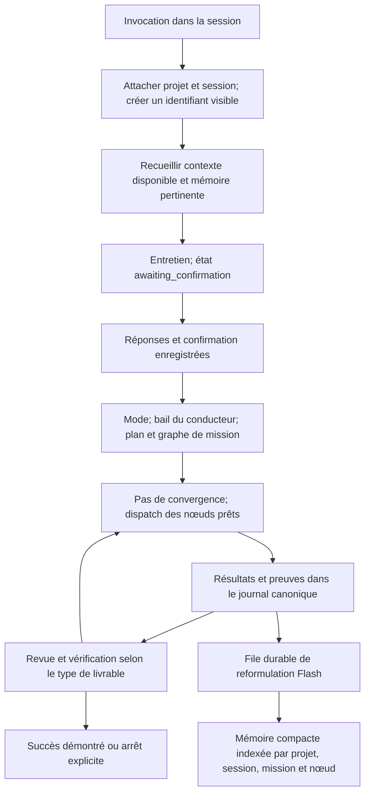

# Audit OMA : incident Symap et conformité à la vision

Date : 10 septembre 2026. Code audité : `4c5b2ba6a23e5b34a4ed5d1b4995932087debfa5`.
Périmètre : diagnostic de la solution OMA, de ses installations et du lancement Symap retrouvé. Ce document ne certifie pas la synchronisation des bases métier de Symap.

## Verdict

OMA possède désormais les composants d'une orchestration en session, mais ne garantit pas leur utilisation, leur identité commune ni la validité de leurs verdicts. L'incident n'est pas un simple défaut d'affichage du CLI.

Le lancement AGY retrouvé a exécuté un audit ordinaire et produit un fichier dans la mémoire de l'hôte. Il n'a pas constitué de mission OMA. Les hooks OMA étaient rejetés au chargement. En outre, des reproductions sur le broker réel démontrent des défauts indépendants : succès sans travail métier, succès forcé avec un nœud encore prêt, rattachement d'une mission étrangère au graphe courant, progression périmée et séparation entre mémoire écrite et mémoire relue.

Les anciens rapports du dépôt ne décrivent plus exactement le code courant : `plan_route`, `converge_step`, `graph_replan`, l'ingestion mission vers SQLite et la compaction existent bien. Il faut consolider leurs contrats, plutôt que recréer ces composants ou ajouter des agents.

## 1. Ce qui s'est passé dans Symap

La conversation retrouvée est `d9cef86b-978c-43d8-889b-cb84720df89a`, stockée dans la base locale AGY. Son objectif est une variante très proche de celui fourni : `/oma-start "Audit complet de la solution, synchronisation des bases de données et dette technique"`. Il ne faut pas la confondre avec une preuve exhaustive de tous les essais AGY et IDE mentionnés.

Chronologie du log `cli-20260910_110833.log` :

| Heure telle qu'écrite dans le log | Observation |
|---|---|
| 11:08:34 | Le serveur AGY démarre avec le workspace `C:\Users\User\Documents\Repos\Symap`. |
| 11:08:40 | Réception de `/oma-start`, création de la conversation identifiée. |
| 11:08:41 | Rejet des hooks OMA : `invalid hook "oma-memory-summarizer": command hook must specify 'command'`. |
| 11:08:56 | Présentation de l'entretien par `ask_question`. |
| 11:09:35 | Réception de trois réponses utilisateur. |
| Ensuite | Lectures et recherches dans le projet. Plusieurs erreurs du parseur de résultats grep de l'hôte apparaissent. |

La lecture en mode SQLite read-only retrouve 126 étapes, dont 62 enregistrements d'appels d'outils reconnus : 1 `ask_question`, 13 `list_dir`, 30 `view_file`, 2 `find_by_name`, 15 `grep_search`, 1 `write_to_file`. Aucun `graph_init`, `plan_route`, `converge_step` ni outil Brain n'y figure comme appel exécuté. Les mentions de ces noms dans le prompt ne sont pas comptées comme des appels.

Le résultat existe réellement :

[Rapport Symap produit par AGY](C:/Users/User/.gemini/antigravity-cli/brain/d9cef86b-978c-43d8-889b-cb84720df89a/audit_complet_symap_architecture_db_dette.md)

Fichier de 24 789 octets, daté du 10 septembre à 11:13 par le système de fichiers. Son en-tête revendique un « Mode OMA », mais les traces ne justifient pas une orchestration OMA. Son contenu métier n'a pas été contre-audité ici. Ce fichier n'est pas le Brain SQLite d'OMA.

`oma status` reproduit le message signalé et `Symap\.oma` est absent. Cela correspond à l'absence d'initialisation OMA dans la conversation retrouvée. L'explication « il attend simplement tes réponses » est écartée pour cet essai : les réponses sont enregistrées.

### Installation et limites de causalité

- Le premier CLI dans le PATH est le shim npm sous `C:\nvm4w\nodejs`; son package est lié au checkout `ohmyagy` audité. D'autres shims existent, mais celui utilisé ici est identifié.
- Le broker du plugin global et celui du plugin Symap pointent vers le même `dist/src/mcp/broker-server.js`.
- Le plugin global n'impose plus `OMA_WORKSPACE_ROOT`. Le plugin local Symap impose bien Symap. L'ancien défaut de racine globale codée en dur n'est donc pas reproduit.
- Le fichier supplémentaire `Symap\.agents\mcp_config.json` a été modifié à 11:12:27, après le démarrage et l'entretien de la conversation. Sa présence actuelle ne prouve pas son chargement à 11:08.
- `agy mcp list` affiche aujourd'hui `oma-broker` activé. C'est une preuve de configuration actuelle, pas une preuve de disponibilité dans l'ancienne conversation.
- Le fichier global MCP de l'IDE Antigravity examiné ne contient pas OMA. Le chargement éventuel depuis d'autres mécanismes de plugins n'est pas exclu par cette observation.
- Les logs IDE présentent eux aussi le rejet des hooks OMA. La trajectoire exacte de l'essai IDE cité n'a pas été identifiée.

Conclusion causale : le flux réel a quitté les instructions OMA après l'entretien. Le défaut d'intégration hooks est établi. La raison exacte pour laquelle aucun outil OMA n'a été appelé dans cette session, indisponibilité des outils ou choix du conducteur malgré leur disponibilité, reste à distinguer avec un inventaire d'outils de cette session. Réinstaller à l'aveugle ne démontre aucune réparation.

## 2. Défauts reproduits sur le broker réel

Reproduction : `node docs/audits/2026-09-10-oma/probe.mjs`, après compilation. Le script utilise Node, le broker compilé, des messages JSON-RPC avec initialisation MCP et des dossiers temporaires neufs. Il ne lance aucun agent IA et ne modifie pas les données Symap.

Résultats détaillés : [probe-results.json](C:/Users/User/Documents/Repos/plugins/ohmyagy/docs/audits/2026-09-10-oma/probe-results.json).

| Priorité | Scénario réel | Résultat observé et conséquence |
|---|---|---|
| P0 | `graph_init` avec objectif seul, puis `converge_step` | `succeeded`, 1/1 accepté, aucun artifact métier. Le bootstrap synthétique est pris pour l'objectif accompli. La skill prévoit bien un planner avant la convergence, mais le serveur n'impose pas cette précondition. |
| P0 | Un nœud `ready`, puis `converge_step({isIntegrated:true})` | `succeeded` avec un nœud toujours prêt et 0/1 accepté. Une assertion de l'appelant court-circuite la preuve de réussite. |
| P0 | Graphe de `mission-a` terminé, puis `converge_step({missionId:"unrelated-mission"})` | Création d'un journal pour la mission étrangère et succès basé sur le graphe A. Le CLI rapporte cette mission étrangère réussie alors que son journal ne contient aucun work item. |
| P1 | Terminer A puis initialiser B dans le même workspace | Rejet : `Graph event store is already initialized`. Le chemin session-native ne possède qu'un emplacement global `.oma/graph` sans cycle de remplacement exposé par `graph_init`. |
| P1 | Premier pas avec 0/1 accepté, terminer le nœud, nouveau pas sans fournir de progression | Le verdict devient `succeeded` mais le vecteur reste à 0/1. Le moteur réutilise le dernier vecteur historique au lieu de recalculer les compteurs de nœuds. |
| P1 | Deux `brain_summarize({context,actions})`, puis `brain_query({})` | Deux sessions Brain sont créées; la requête renvoie zéro entrée. Les résumés sont enregistrés dans `interaction_summaries`, alors que la requête lit `memory_entries`. Ce n'est pas un simple filtre de session : l'interface de lecture n'interroge pas la table écrite dans ce cas. |

Le dernier cas n'affirme pas que toute la mémoire est introuvable : fournir `content` à `brain_summarize` écrit aussi une entrée de mémoire que `brain_query` peut retrouver. La skill utilise actuellement `content`. Le défaut reste que les deux formes d'appel acceptées ne produisent pas la même capacité de reprise et que l'absence de `sessionId` crée une session à chaque appel, même dans un unique processus MCP.

Sources principales :

- [Initialisation, bootstrap et journal mission](C:/Users/User/Documents/Repos/plugins/ohmyagy/src/mcp/graph-tools.ts:265)
- [Résolution mission et convergence](C:/Users/User/Documents/Repos/plugins/ohmyagy/src/mcp/orchestration-tools.ts:176)
- [Calcul de progression et contournement par isIntegrated](C:/Users/User/Documents/Repos/plugins/ohmyagy/src/orchestration/convergence-step.ts:64)
- [Lecture et écriture mémoire MCP](C:/Users/User/Documents/Repos/plugins/ohmyagy/src/mcp/brain-tools.ts:245)

## 3. Écarts structurels confirmés dans le code

### Le propriétaire de session n'est pas un contrat durable

L'identité du graphe, celle de la mission, la session Brain et la session de l'hôte sont distinctes. `.oma/graph/session-mission-id` aide la sélection automatique, mais ne constitue pas un bail exclusif liant toutes les mutations à une session et à une époque de propriété.

Le verrou de graphe protège des écritures du graphe. Il ne donne pas à lui seul la propriété de la mission. `MissionEventsStore.appendEvent` lit les événements, calcule `seq` et le hash précédent, puis ajoute une ligne sans verrou commun couvrant ces opérations. Deux processus peuvent lire la même tête. Ce risque de concurrence est identifié dans le code; il n'a pas été reproduit par une course multiprocessus lors de cet audit.

[Chemin singleton et verrou graphe](C:/Users/User/Documents/Repos/plugins/ohmyagy/src/graph/store.ts:66), [append du journal mission](C:/Users/User/Documents/Repos/plugins/ohmyagy/src/ledger/mission-events.ts:172).

### Entretien : présent dans le prompt, absent du cycle d'état serveur

L'entretien a bien fonctionné dans la conversation retrouvée. Mais aucun état durable `awaiting_confirmation` n'est créé avant lui, et le serveur ne demande pas de confirmation enregistrée pour accepter `graph_init`. Les tests de la skill vérifient notamment la présence des formulations obligatoires dans le Markdown. Ils ne prouvent pas que le modèle s'y conforme.

Correction d'une possible confusion : `graph_init` crée déjà le journal mission via `ensureMissionStarted`. Il ne faut pas attendre `converge_step` pour que le CLI voie une mission initialisée correctement. L'angle mort concerne l'amont de `graph_init` et les défaillances de lancement.

[Instructions d'entretien](C:/Users/User/Documents/Repos/plugins/ohmyagy/src/plugin-assets/skills/oma-start/SKILL.md:49), [création immédiate du journal](C:/Users/User/Documents/Repos/plugins/ohmyagy/src/mcp/graph-tools.ts:331).

### Mémoire : trois chemins différents

1. Le hook appelle bien un reformulateur Gemini Flash via `AgyDriver`.
2. L'outil MCP `brain_summarize` enregistre les champs fournis par le conducteur. Il n'appelle pas Flash.
3. `ingestMissionIntoBrain` fabrique des descriptions déterministes depuis les nœuds et événements. Il n'appelle pas Flash non plus.

« Chaque échange et chaque run passent toujours par Flash » n'est donc pas vrai. Les erreurs du hook sont avalées; les données non reconnues peuvent produire une extraction vide; le fallback après échec du reformulateur ne conserve que 600 caractères. L'extracteur prend au plus six messages quand un tableau de messages est fourni et ne lit pas un simple `transcript_path`. L'historique complet de l'hôte n'est pas automatiquement importé.

La compaction existe déjà. Le problème prioritaire est la capture, l'identité, la consultation et la preuve du dernier événement traité. La récupération de résumés ne doit pas être présentée comme la récupération intégrale d'une conversation que l'hôte n'expose pas.

[Hook et mapping de sessions](C:/Users/User/Documents/Repos/plugins/ohmyagy/src/brain/summarizer-hook.ts:25), [fallback et extraction](C:/Users/User/Documents/Repos/plugins/ohmyagy/src/brain/summarizer.ts:87), [Flash](C:/Users/User/Documents/Repos/plugins/ohmyagy/src/brain/flash-summarizer.ts:64), [ingestion déterministe](C:/Users/User/Documents/Repos/plugins/ohmyagy/src/brain/mission-ingest.ts:185).

### Les stockages OMA ne sont pas synchronisés de façon garantie

Le graphe et son journal, le journal de mission et SQLite ont des écritures séparées. `graph_apply` et `graph_mark_node` peuvent réussir alors que l'écriture du suivi mission échoue dans un `catch {}`. `converge_step` tente ensuite l'ingestion Brain, également sans exposer son échec. Il n'existe pas de transaction commune ou de file durable de rattrapage sur ce trajet.

Cela n'établit aucune divergence des bases métier BigQuery, Firestore, etc. de Symap : cette question exige un autre audit des applications, connecteurs et données réelles. Fusionner les bases métier n'est pas une correction d'OMA.

### Validation d'installation insuffisante

`oma doctor --strict` annonce le plugin valide. `agy plugin validate` annonce lui aussi deux hooks traités. Pourtant, le runtime AGY de la conversation et les logs IDE rejettent ces hooks. La validation statique de packaging et le chargement effectif ne testent pas le même contrat.

L'installeur émet un objet avec `PreToolUse`/`Stop` imbriqués sous les noms de hooks; le parseur runtime réclame un champ `command` au niveau du hook qu'il lit. Le format exact accepté, les événements supportés et le payload doivent être capturés sur les deux hôtes avant de modifier le générateur. Corriger seulement la présence d'une clé pour satisfaire un test local reproduirait le défaut de méthode.

[Génération des hooks](C:/Users/User/Documents/Repos/plugins/ohmyagy/src/packaging/install.ts:90), [doctor](C:/Users/User/Documents/Repos/plugins/ohmyagy/src/runtime/doctor.ts:131).

## 4. Matrice de conformité

| Vision | État courant |
|---|---|
| Invocation à tout moment dans la session active | Commande et skill présentes; orchestration réelle non garantie, échec observé après entretien. |
| Reprendre une mission depuis une autre session | Journaux persistants présents; propriétaire, transfert et rattachement au bon graphe non garantis. |
| Récupérer le contexte conversationnel et l'historique projet | Contexte visible du modèle et requête Brain disponibles; import intégral de l'hôte absent. |
| Questions avant lancement | Réussi dans la trace; règle textuelle, sans garde centrale ni état d'attente visible. |
| Choisir les rôles selon le besoin | `plan_route` et modes diagnostic/bugfix/feature/infra/pm présents; exécution effective non imposée. |
| Six rôles seulement | Six rôles canoniques présents; alias `worker`, persona `fixer` et fichiers de résumeur restent à réconcilier. Le résumeur devrait être une fonction interne sur le rôle explorer. |
| Dynamic workflow | Propositions CAS, convergence et replanning implémentés; verdicts et rattachement mission défectueux. |
| Processus, agents et mémoire reliés par le graphe | Références et ingestion présentes; pas de contrôle de propriété couvrant l'ensemble. |
| Chaque interaction/run reformulé par Flash | Non satisfait : hook rejeté et deux chemins mémoire sans Flash. |
| Mémoire compacte et persistante | SQLite et compaction présents; continuité de lecture/capture partielle. |
| Statut fidèle et observable | Lecture du journal présente; lancement invisible, faux succès et incohérences reproduits. |
| Aucun mélange entre plusieurs runs | Non satisfait : attribution inter-mission reproduite; risque concurrent supplémentaire dans le journal. |

## 5. Remédiation proposée, sans multiplication des agents

La session doit conserver le raisonnement et le dialogue. Le broker doit imposer les transitions et leurs preuves. Les agents restent `orchestrator`, `planner`, `explorer`, `executor`, `reviewer`, `verifier`.

Flux cible :

Créer l'enregistrement d'accueil avant l'entretien ne signifie pas exécuter le travail avant confirmation. Cela permet d'afficher « attente de réponses », « outils indisponibles » ou « contexte incomplet » au lieu de ne rien retrouver.

Ordre des lots :

1. **Contrat hôte vérifié.** Capturer chargement MCP, événements hooks et payloads réels dans AGY et IDE. Vérifier un petit callback enregistré, puis le parcours slash → entretien → identifiant → statut. Le doctor doit distinguer installé, chargé et testé.
2. **Identité et cycle de mission.** Lier racine canonique du projet, session hôte, mission, graphe et propriétaire. Baux avec époque de reprise; refus des anciennes sessions. Graphe résolu par mission, permettant A puis B sans supprimer l'historique. Journal sérialisé avec contrôle de tête.
3. **Contrat de réussite.** Le bootstrap ne valide pas l'objectif. Refuser le succès forcé. Recalculer les compteurs depuis les preuves courantes; imposer critères de livraison et vérification adaptés aux audits comme au code. Un audit doit produire un artifact déclaré et vérifié, sans exiger artificiellement une modification Git.
4. **Mémoire fiable.** File durable indexée sur l'événement source; idempotence et curseur de consommation. Flash reformule par AGY avec une prévention explicite de récursion des hooks. En cas d'échec, afficher un retard de mémoire et reprendre le traitement. Une seule interface doit retrouver faits et résumés utiles des sessions précédentes. Ne pas stocker sans limite les transcriptions complètes dans la petite base.
5. **Cohérence et nettoyage.** Un journal autoritatif; projections graphe/statut/Brain reconstruites ou rattrapées de manière observable. Supprimer les chemins de taxonomie contradictoires après vérification des appelants. Actualiser les anciens rapports.

Il n'est pas nécessaire de fusionner immédiatement tous les fichiers en une grosse base. Garder le journal canonique et reconstruire les projections est un premier chemin cohérent. Une migration ultérieure vers un stockage SQLite transactionnel unique pour les métadonnées est possible, mais doit prévoir sauvegarde, version de schéma, import idempotent et validation des liens projet/session/mission. Ne pas fusionner directement les SQLite hôtes AGY/IDE avec le Brain OMA : ce sont des formats et des responsabilités différents.

La référence [claude-mem](https://github.com/thedotmack/claude-mem) n'est utilisée que pour le principe capture → condensation → récupération. Aucune dépendance ni installation de ce projet n'a été ajoutée.

## 6. Conditions de validation de la correction

- Rejouer dans **AGY et l'IDE**, sur un projet neuf : invocation en milieu de conversation, récupération d'un fait antérieur contrôlé, entretien, zéro exécution métier avant réponse, puis ID visible immédiatement dans le statut.
- Interrompre une mission et la reprendre depuis une autre session : même mission, même graphe et bon contexte; l'ancien propriétaire ne peut plus publier.
- Terminer A puis lancer B dans le même projet; empêcher toute attribution des résultats A à B.
- Deux processus écrivant dans le journal ne doivent pas partager une séquence ou une tête précédente invalide.
- Les scénarios de `probe.mjs` doivent recevoir des refus ou états cohérents : pas de succès avec nœud prêt, pas de succès bootstrap, pas de mission étrangère, progrès actuel.
- Capture Flash réelle puis panne volontaire : état du traitement visible, reprise sans doublon, récupération dans une nouvelle session et absence de boucle de hooks.
- Comparer après interruption les IDs, révisions, têtes de journaux, nombre d'événements ingérés et artifacts accessibles depuis le CLI et l'hôte.

## 7. Preuves et limites

[Preuves hôte expurgées](C:/Users/User/Documents/Repos/plugins/ohmyagy/docs/audits/2026-09-10-oma/host-evidence.json), [journal des 26 tests](C:/Users/User/Documents/Repos/plugins/ohmyagy/docs/audits/2026-09-10-oma/session-tests.log), [journal des 74 tests](C:/Users/User/Documents/Repos/plugins/ohmyagy/docs/audits/2026-09-10-oma/memory-tests.log).

- Build TypeScript : réussi.
- Tests ciblés session/convergence/observabilité : **26 réussis, 0 échec**, 3 fichiers.
- Tests ciblés Brain/graphe/routage : **74 réussis, 0 échec**, 7 fichiers.
- Reproductions via processus MCP réel et lecture CLI : les défauts ci-dessus sont observés. Les résultats restent des fixtures synthétiques, pas des missions métier achevées.
- Preuve hôte : log de lancement, entretien répondu, rejet hooks, appels d'outils et rapport de la conversation AGY retrouvée. Rejet hooks également observé dans les logs IDE.
- Non exécutés : suite complète, nouvelle mission authentifiée AGY/IDE, appel réel de reformulation Flash, audit des bases cloud métier, course multiprocessus du journal.
- Aucun correctif du code produit ni changement de configuration globale réalisé. Le build a régénéré `dist`; les sources produit restent au SHA annoncé. Le travail préexistant dans `.claude/worktrees/oma-skeleton` est conservé.

Cet audit termine l'analyse demandée. Il ne déclare pas la solution réparée.
